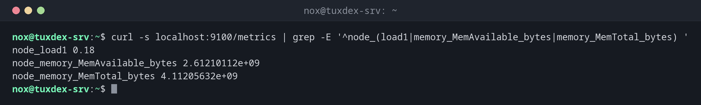

# node_exporter

> Der Prometheus-Exporter für Linux-Server: liefert Werte zu CPU, Speicher, Platten, Dateisystemen und Netzwerk auf Port 9100. Unter Debian und Ubuntu heißt das Programm `prometheus-node-exporter`.



## Syntax

```bash
node_exporter [--web.listen-address=:9100] [--collector.NAME | --no-collector.NAME]
```

## Optionen

| Option | Beschreibung |
|--------|--------------|
| `--web.listen-address=` | Adresse und Port, Standard `:9100` |
| `--collector.textfile.directory=` | Zusätzlich `*.prom`-Dateien aus diesem Verzeichnis lesen |
| `--collector.systemd` | Den Collector für systemd-Units einschalten (standardmäßig aus) |
| `--no-collector.NAME` | Einen Collector abschalten, z. B. `--no-collector.wifi` |
| `--collector.disable-defaults` | Ohne Collectors starten und dann einzelne einschalten |
| `--web.config.file=` | Datei mit Einstellungen für TLS und Basic Auth |

Unter Debian und Ubuntu kommen die Optionen in `ARGS="…"` in `/etc/default/prometheus-node-exporter`; danach `sudo systemctl restart prometheus-node-exporter`.

## Beispiele

**Ein paar Werte direkt vom Exporter:**

```bash
curl -s localhost:9100/metrics | grep -E '^node_(load1|memory_MemAvailable_bytes|memory_MemTotal_bytes) '
```

```text
node_load1 0.18
node_memory_MemAvailable_bytes 2.61210112e+09
node_memory_MemTotal_bytes 4.11205632e+09
```

**Läuft der Dienst:**

```bash
systemctl status prometheus-node-exporter --no-pager | head -3
```

```text
● prometheus-node-exporter.service - Prometheus exporter for machine metrics
     Loaded: loaded (/usr/lib/systemd/system/prometheus-node-exporter.service; enabled; preset: enabled)
     Active: active (running) since Mon 2026-10-26 10:42:17 CET; 2h 11min ago
```

**Freier Platz im Wurzeldateisystem:**

```bash
curl -s localhost:9100/metrics | grep 'node_filesystem_avail_bytes.*mountpoint="/"'
```

```text
node_filesystem_avail_bytes{device="/dev/sda2",device_error="",fstype="ext4",mountpoint="/"} 2.4823209984e+10
```

Werte stehen immer in Grundeinheiten: Bytes, Sekunden. `2.48e+10` Bytes sind etwa 23 GiB.

**Ein eigener Wert über den Textfile-Collector:**

```bash
echo "backup_last_success_timestamp_seconds $(date +%s)" > /tmp/backup.prom
sudo mv /tmp/backup.prom /var/lib/prometheus/node-exporter/
curl -s localhost:9100/metrics | grep ^backup_
```

```text
backup_last_success_timestamp_seconds 1.793007737e+09
```

Eine Alarmregel wie `time() - backup_last_success_timestamp_seconds > 86400` meldet dann ein Backup, das seit einem Tag nicht gelaufen ist.

**Collectors, die nichts gefunden haben:**

```bash
curl -s localhost:9100/metrics | grep '^node_scrape_collector_success.* 0$'
```

```text
node_scrape_collector_success{collector="bonding"} 0
node_scrape_collector_success{collector="fibrechannel"} 0
node_scrape_collector_success{collector="infiniband"} 0
node_scrape_collector_success{collector="tapestats"} 0
node_scrape_collector_success{collector="zfs"} 0
```

`0` ist hier kein Fehler: Der Server hat einfach kein Netzwerk-Bonding, kein Fibre Channel, kein InfiniBand, kein Bandlaufwerk und kein ZFS.

## Wann brauche ich das?

- Auf jedem Server, den Prometheus überwachen soll
- Um von Hand zu prüfen, welche Werte ein Server liefert, bevor du eine Regel schreibst
- Um eigene Werte in Prometheus zu bringen, etwa den Zeitpunkt des letzten erfolgreichen Backups

!!! tip "Eigene Metriken mit dem Textfile-Collector"
    Ein Skript schreibt Zeilen wie `backup_last_success_timestamp_seconds 1793007737` in eine
    `.prom`-Datei im Textfile-Verzeichnis. Der Node Exporter liefert sie bei jedem Scrape mit:
    ideal für Cronjobs. Schreib erst in eine temporäre Datei und benenne sie dann um, damit der
    Exporter nie eine halbe Datei liest.

!!! warning "Port 9100 ist für alle offen"
    Der Node Exporter hat standardmäßig keine Anmeldung. Erlaube den Port nur vom
    Prometheus-Server, etwa mit [`ufw`](../11-network/ufw.md): `sudo ufw allow from 192.0.2.10 to any port 9100 proto tcp`.

## Unterschiede zwischen Distributionen

| | Debian | Ubuntu | RHEL | Arch |
|---|--------|--------|------|------|
| Paket | `prometheus-node-exporter` | `prometheus-node-exporter` | nicht in den Paketquellen: Release-Archiv oder Container `prom/node-exporter` | `prometheus-node-exporter` |
| Programm und Dienst | `prometheus-node-exporter` | `prometheus-node-exporter` | `node_exporter` | `prometheus-node-exporter` |
| Optionen in | `/etc/default/prometheus-node-exporter` | `/etc/default/prometheus-node-exporter` | eigene systemd-Unit | `/etc/conf.d/prometheus-node-exporter` |

## Verwandte Befehle

[prometheus](prometheus.md) · [promtool](promtool.md) · [curl](../11-network/curl.md) · [systemctl](../09-systemd/systemctl.md)
