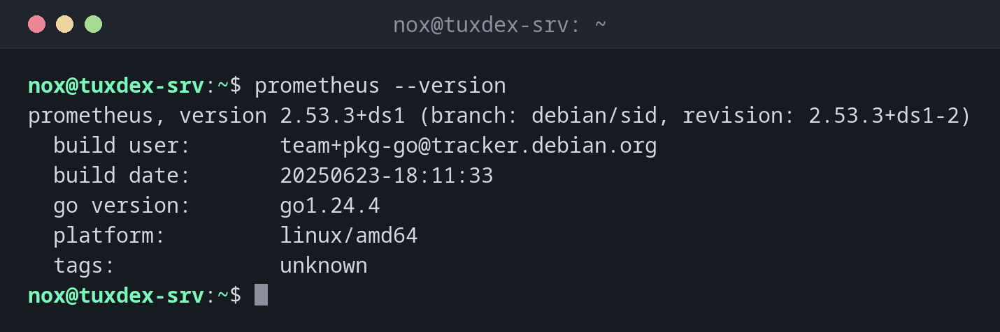

# prometheus

> Der Prometheus-Server: sammelt Metriken von allen Zielen, speichert sie als Zeitreihen und wertet Alarmregeln aus.



## Syntax

```bash
prometheus [--config.file=DATEI] [--storage.tsdb.path=VERZ] [--storage.tsdb.retention.time=ZEIT]
```

## Optionen

| Option | Beschreibung |
|--------|--------------|
| `--config.file=` | Konfigurationsdatei, meist `/etc/prometheus/prometheus.yml` |
| `--storage.tsdb.path=` | Verzeichnis für die Daten |
| `--storage.tsdb.retention.time=` | Wie lange Daten aufbewahrt werden, Standard `15d` |
| `--storage.tsdb.retention.size=` | Höchstgröße der Daten, z. B. `20GB` |
| `--web.listen-address=` | Adresse und Port, Standard `:9090` |
| `--web.enable-lifecycle` | Neuladen per `POST /-/reload` erlauben |
| `--version` | Version und Build-Informationen |

Unter Debian und Ubuntu kommen die Optionen in `ARGS="…"` in `/etc/default/prometheus`. `sudo systemctl reload prometheus` liest die Konfiguration ohne Neustart neu ein.

## Beispiele

**Version des Servers:**

```bash
prometheus --version
```

```text
prometheus, version 2.53.3+ds1 (branch: debian/sid, revision: 2.53.3+ds1-2)
  build user:       team+pkg-go@tracker.debian.org
  build date:       20250623-18:11:33
  go version:       go1.24.4
  platform:         linux/amd64
  tags:             unknown
```

**Ist Prometheus gesund:**

```bash
curl -s localhost:9090/-/healthy
```

```text
Prometheus Server is Healthy.
```

**Die Scrape-Ziele in der Konfiguration:**

```bash
grep -A3 'job_name: node' /etc/prometheus/prometheus.yml
```

```text
  - job_name: node
    static_configs:
      - targets: ['localhost:9100', '192.0.2.21:9100', '192.0.2.22:9100']
```

**Ein Ziel ergänzen und neu laden:**

```bash
sudoedit /etc/prometheus/prometheus.yml
promtool check config /etc/prometheus/prometheus.yml >/dev/null && sudo systemctl reload prometheus
systemctl is-active prometheus
```

```text
active
```

**Welche Ziele nicht erreichbar sind und warum:**

```bash
curl -s localhost:9090/api/v1/targets | jq -r '.data.activeTargets[] | "\(.labels.instance) \(.health) \(.lastError)"'
```

```text
192.0.2.21:9100 down Get "http://192.0.2.21:9100/metrics": context deadline exceeded
192.0.2.22:9100 up
localhost:9100 up
localhost:9090 up
```

`context deadline exceeded` heißt: keine Antwort innerhalb des Scrape-Timeouts. Der Server ist aus, oder eine Firewall verwirft Port 9100.

**Wie viel Platz die Daten belegen:**

```bash
sudo du -sh /var/lib/prometheus/metrics2
```

```text
1.2G	/var/lib/prometheus/metrics2
```

## Wann brauche ich das?

- Um ein zentrales Monitoring für mehrere Server aufzusetzen
- Um herauszufinden, warum ein Ziel `down` ist
- Um zu begrenzen, wie viel Plattenplatz die Monitoring-Daten belegen

!!! tip "Die Weboberfläche für schnelle Prüfungen"
    `http://tuxdex-srv:9090` hat die Seiten *Graph* für PromQL-Abfragen, *Status > Targets*
    mit jedem Ziel und seinem letzten Fehler und *Alerts* mit dem Zustand aller Regeln. Von
    einem anderen Rechner aus über einen SSH-Tunnel: `ssh -L 9090:localhost:9090 nox@tuxdex-srv`.

!!! warning "Den Plattenplatz einplanen"
    Jedes Ziel erzeugt etwa tausend Zeitreihen. Mit vielen Servern und langer Aufbewahrung
    wächst das Datenverzeichnis auf viele Gigabyte. Setz `--storage.tsdb.retention.size`,
    damit eine volle Platte nicht das Monitoring anhält.

## Unterschiede zwischen Distributionen

| | Debian | Ubuntu | RHEL | Arch |
|---|--------|--------|------|------|
| Paket | `prometheus` | `prometheus` | nicht in den Paketquellen: Release-Archiv oder Container `prom/prometheus` | `prometheus` |
| Optionen in | `/etc/default/prometheus` | `/etc/default/prometheus` | eigene systemd-Unit | `/etc/conf.d/prometheus` |
| Daten | `/var/lib/prometheus/metrics2` | `/var/lib/prometheus/metrics2` | je nach Einrichtung | `/var/lib/prometheus/data` |

## Verwandte Befehle

[node_exporter](node_exporter.md) · [promtool](promtool.md) · [amtool](amtool.md) · [jq](../05-text-processing/jq.md)
