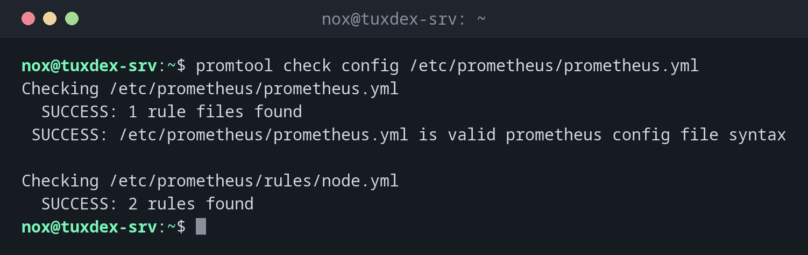

# promtool

> Der Werkzeugkasten von Prometheus: prüft Konfiguration und Alarmregeln, führt PromQL-Abfragen auf der Kommandozeile aus und testet Regeln.



## Syntax

```bash
promtool check config DATEI
promtool check rules DATEI...
promtool query instant URL ABFRAGE
```

## Optionen

| Befehl | Beschreibung |
|--------|--------------|
| `check config DATEI` | `prometheus.yml` und die darin genannten Regeldateien prüfen |
| `check rules DATEI...` | Regeldateien prüfen |
| `check metrics` | Metriken von stdin gegen die Namensregeln prüfen |
| `query instant URL ABFRAGE` | Eine PromQL-Abfrage gegen einen Server ausführen |
| `query range URL ABFRAGE --start --end` | Einen Zeitraum abfragen |
| `test rules DATEI` | Unit-Tests für Alarmregeln ausführen |

`promtool` kommt mit dem Paket `prometheus`. Sein Exit-Code ist `0`, wenn alles gültig ist, deshalb passt es gut in Skripte und CI.

## Beispiele

**Die Konfiguration samt Regeln prüfen:**

```bash
promtool check config /etc/prometheus/prometheus.yml
```

```text
Checking /etc/prometheus/prometheus.yml
  SUCCESS: 1 rule files found
 SUCCESS: /etc/prometheus/prometheus.yml is valid prometheus config file syntax

Checking /etc/prometheus/rules/node.yml
  SUCCESS: 2 rules found

```

**Ein Fehler in einer Regeldatei:**

```bash
promtool check rules /etc/prometheus/rules/node.yml
```

```text
Checking /etc/prometheus/rules/node.yml
  FAILED:
/etc/prometheus/rules/node.yml: unknown unit " minutes" in duration "2 minutes"
```

Zeitangaben schreibt man als `2m`, `1h` oder `7d`.

**Ein Fehler in der Konfiguration:**

```bash
promtool check config /etc/prometheus/prometheus.yml
```

```text
Checking /etc/prometheus/prometheus.yml

  FAILED: parsing YAML file /etc/prometheus/prometheus.yml: not a valid duration string: "15"
```

Bei `scrape_interval: 15` fehlt die Einheit; richtig ist `15s`.

**Welche Ziele nicht erreichbar sind:**

```bash
promtool query instant http://localhost:9090 'up == 0'
```

```text
up{instance="192.0.2.21:9100", job="node"} => 0 @[1793007737.358]
```

**RAM-Auslastung aller Server in Prozent:**

```bash
promtool query instant http://localhost:9090 \
  '100 * (1 - node_memory_MemAvailable_bytes / node_memory_MemTotal_bytes)'
```

```text
{instance="192.0.2.22:9100", job="node"} => 71.48203125 @[1793007737.358]
{instance="localhost:9100", job="node"} => 36.47693447 @[1793007737.358]
```

**Welche Alarme gerade auslösen:**

```bash
promtool query instant http://localhost:9090 ALERTS
```

```text
ALERTS{alertname="InstanceDown", alertstate="firing", instance="192.0.2.21:9100", job="node", severity="critical"} => 1 @[1793007737.358]
```

## Wann brauche ich das?

- Vor jedem Neuladen von Prometheus, nach Änderungen an Konfiguration oder Regeln
- In der CI, damit kaputte Regeln nie auf dem Server landen
- Für schnelle Abfragen im Terminal, ohne die Weboberfläche zu öffnen

!!! tip "Regeln in der CI prüfen"
    Ein Schritt `promtool check rules rules/*.yml` in deiner Pipeline findet Tippfehler vor
    dem Merge. Mit `promtool test rules` weist du sogar nach, dass ein Alarm bei bestimmten
    Werten auslöst.

!!! warning "Gültig heißt nicht sinnvoll"
    `check rules` prüft die Syntax. Eine Regel mit falschem Metriknamen ist gültig und löst
    einfach nie aus. Teste neue Ausdrücke erst mit `promtool query instant`: keine Ausgabe
    heißt keine Daten.

## Unterschiede zwischen Distributionen

| | Debian | Ubuntu | RHEL | Arch |
|---|--------|--------|------|------|
| Paket | `prometheus` | `prometheus` | im Release-Archiv von Prometheus | `prometheus` |

## Verwandte Befehle

[prometheus](prometheus.md) · [amtool](amtool.md) · [node_exporter](node_exporter.md) · [yamllint](../22-ci-cd/yamllint.md)
