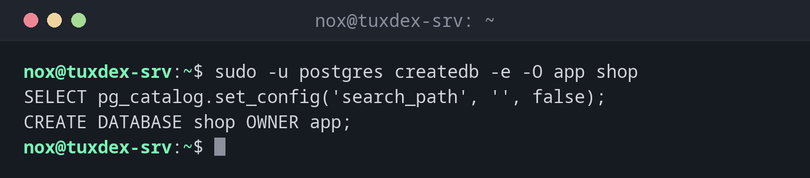

# createdb

> Legt eine neue PostgreSQL-Datenbank an, meist mit einer eigenen Rolle als Besitzer.



## Syntax

```bash
createdb [-O BESITZER] [-E KODIERUNG] [-T VORLAGE] [-e] NAME
```

## Optionen

| Option | Beschreibung |
|--------|--------------|
| `-O ROLLE` | Besitzer der neuen Datenbank |
| `-E UTF8` | Zeichenkodierung |
| `-T template0` | Von einer sauberen Vorlage kopieren (nötig für andere Kodierung oder Locale) |
| `--locale=` | Sortierung und Zeichenklassen, z. B. `C.UTF-8` |
| `-e` | Das SQL zeigen, das an den Server geht |

`createdb` ist eine Hülle um `CREATE DATABASE`. Eine Datenbank löschst du mit `dropdb NAME`.

## Beispiele

**Eine Datenbank für eine Anwendung:**

```bash
sudo -u postgres createdb -e -O app shop
```

```text
SELECT pg_catalog.set_config('search_path', '', false);
CREATE DATABASE shop OWNER app;
```

**Die Datenbank gibt es schon:**

```bash
sudo -u postgres createdb shop
```

```text
createdb: error: database creation failed: ERROR:  database "shop" already exists
```

**Eine Locale, die das System nicht hat:**

```bash
sudo -u postgres createdb -O app -T template0 --locale=de_DE.UTF-8 wiki
```

```text
createdb: error: database creation failed: ERROR:  invalid LC_COLLATE locale name: "de_DE.UTF-8"
HINT:  If the locale name is specific to ICU, use ICU_LOCALE.
```

Erzeuge die Locale vorher (unter Debian mit `sudo dpkg-reconfigure locales`), starte PostgreSQL neu und versuch es noch einmal. `C.UTF-8` gibt es immer.

**Eine Datenbank löschen:**

```bash
sudo -u postgres dropdb -e shop2
```

```text
SELECT pg_catalog.set_config('search_path', '', false);
DROP DATABASE shop2;
```

## Wann brauche ich das?

- Beim Einrichten einer neuen Anwendung
- Um vor dem Zurückspielen eines Backups mit `pg_restore` eine leere Datenbank anzulegen

!!! tip "Besitzer statt einzelner Rechte"
    Gehört die Datenbank der Anwendungsrolle (`-O app`), darf sie dort eigene Tabellen anlegen
    und braucht kein weiteres `GRANT`. Andere Rollen bekommen nur, was sie brauchen.

!!! danger "`dropdb` fragt nicht nach"
    `dropdb shop` löscht die Datenbank samt allen Daten sofort. Mach vorher ein frisches
    [`pg_dump`](../28-backup/pg_dump.md) und nimm `dropdb -i` für eine Rückfrage.

## Unterschiede zwischen Distributionen

| | Debian | Ubuntu | RHEL | Arch |
|---|--------|--------|------|------|
| Paket | `postgresql-client` | `postgresql-client` | `postgresql` | `postgresql-libs` |

## Verwandte Befehle

[createuser](createuser.md) · [psql](psql.md) · [pg_dump](../28-backup/pg_dump.md) · [localectl](../09-systemd/localectl.md)
