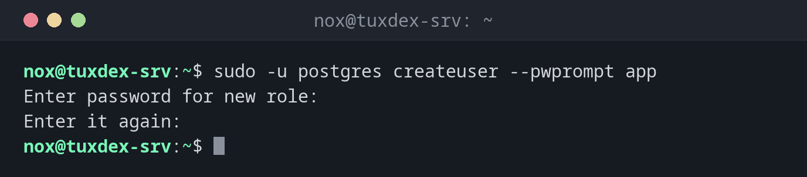

# createuser

> Creates a new PostgreSQL role (user), optionally with a password and rights to create databases.



## Syntax

```bash
createuser [-P] [-d] [-r] [-s] [-e] ROLE
```

## Options

| Option | Description |
|--------|-------------|
| `-P`, `--pwprompt` | Ask for a password for the new role |
| `-d` | The role may create databases |
| `-r` | The role may create other roles |
| `-s` | Superuser: may do everything |
| `-e` | Show the SQL that is sent to the server |
| `--interactive` | Ask for the rights instead of taking defaults |

`createuser` is a wrapper for `CREATE ROLE … LOGIN`. Run it as the Linux user `postgres`: `sudo -u postgres createuser …`. Delete roles with `dropuser`.

## Examples

**A role with a password for an application:**

```bash
sudo -u postgres createuser --pwprompt app
```

```text
Enter password for new role:
Enter it again:
```

**Show what is sent to the server:**

```bash
sudo -u postgres createuser -e nox
```

```text
SELECT pg_catalog.set_config('search_path', '', false);
CREATE ROLE nox NOSUPERUSER NOCREATEDB NOCREATEROLE INHERIT LOGIN NOREPLICATION NOBYPASSRLS;
```

Without options the role may log in, but not create databases or roles.

**A role that may create databases:**

```bash
sudo -u postgres createuser -d -P shopadmin
```

```text
Enter password for new role:
Enter it again:
```

**The role already exists:**

```bash
sudo -u postgres createuser app
```

```text
createuser: error: creation of new role failed: ERROR:  role "app" already exists
```

To set a new password for an existing role: `sudo -u postgres psql -c '\password app'`.

**Check the result:**

```bash
sudo -u postgres psql -c '\du'
```

```text
                             List of roles
 Role name |                         Attributes
-----------+------------------------------------------------------------
 app       |
 nox       |
 postgres  | Superuser, Create role, Create DB, Replication, Bypass RLS
 shopadmin | Create DB

```

## When do I need it?

- For every new application that gets its own database
- To give a colleague a personal login, matching their Linux user name for `peer`

!!! tip "A role per Linux user"
    A role with the same name as a Linux user (`sudo -u postgres createuser nox`) can log in
    locally without a password. `nox` then simply types `psql -d shop`.

!!! warning "No superuser for applications"
    An application with `-s` can read every database, delete everything and run programs on
    the server through `COPY … PROGRAM`. Applications get a normal role that owns its own
    database.

## Distribution differences

| | Debian | Ubuntu | RHEL | Arch |
|---|--------|--------|------|------|
| Package | `postgresql-client` | `postgresql-client` | `postgresql` | `postgresql-libs` |

## Related commands

[createdb](createdb.md) · [psql](psql.md) · [pg_isready](pg_isready.md) · [useradd](../07-users-groups/useradd.md)
