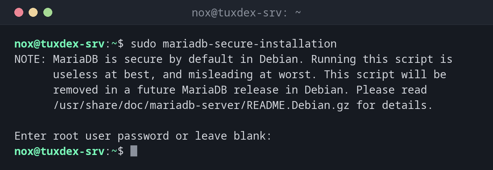

# mariadb-secure-installation

> Secures a fresh MariaDB installation interactively: root login, anonymous users, remote root access and the test database.



## Syntax

```bash
mariadb-secure-installation
```

## Options

| Question | Recommended answer |
|----------|--------------------|
| Switch to unix_socket authentication | `n` if root already uses the socket |
| Change the root password | `n` with socket login, otherwise `y` |
| Remove anonymous users | `y` |
| Disallow root login remotely | `y` |
| Remove test database and access to it | `y` |
| Reload privilege tables now | `y` |

`mysql_secure_installation` is the old name. The script only needs to run once, right after the installation.

## Examples

**The note on Debian:**

```bash
sudo mariadb-secure-installation
```

```text
NOTE: MariaDB is secure by default in Debian. Running this script is
      useless at best, and misleading at worst. This script will be
      removed in a future MariaDB release in Debian. Please read
      /usr/share/doc/mariadb-server/README.Debian.gz for details.

Enter root user password or leave blank:
```

**A run on RHEL or Arch:**

```bash
sudo mariadb-secure-installation
```

```text
Enter current password for root (enter for none):
OK, successfully used password, moving on...

Switch to unix_socket authentication [Y/n] n
 ... skipping.

Change the root password? [Y/n] n
 ... skipping.

Remove anonymous users? [Y/n] y
 ... Success!

Disallow root login remotely? [Y/n] y
 ... Success!

Remove test database and access to it? [Y/n] y
 - Dropping test database...
 ... Success!
 - Removing privileges on test database...
 ... Success!

Reload privilege tables now? [Y/n] y
 ... Success!

Cleaning up...

All done!  If you've completed all of the above steps, your MariaDB
installation should now be secure.

Thanks for using MariaDB!
```

**Check the result:**

```bash
sudo mariadb -e "SELECT User, Host FROM mysql.user; SHOW DATABASES LIKE 'test';"
```

```text
+-------------+-----------+
| User        | Host      |
+-------------+-----------+
| mariadb.sys | localhost |
| mysql       | localhost |
| root        | localhost |
+-------------+-----------+
```

No user with an empty name, no `root` for other hosts, no database `test`.

## When do I need it?

- Right after installing MariaDB on RHEL or Arch
- On servers that were installed long ago and never secured

!!! tip "Not needed on Debian and Ubuntu"
    The packages there are secure by default: `root` logs in only via the socket, and there
    are no anonymous users and no test database. The script says so itself.

!!! warning "Don't lock yourself out"
    If you set a root password and switch off the socket login, `sudo mariadb` no longer
    works without `-p`. Note the password in your password manager before you continue.

## Distribution differences

| | Debian | Ubuntu | RHEL | Arch |
|---|--------|--------|------|------|
| Needed after install | no | no | yes | yes, after `mariadb-install-db` |
| Package | `mariadb-server` | `mariadb-server` | `mariadb-server` | `mariadb` |

## Related commands

[mariadb](mariadb.md) · [mariadb-admin](mariadb-admin.md) · [systemctl](../09-systemd/systemctl.md)
