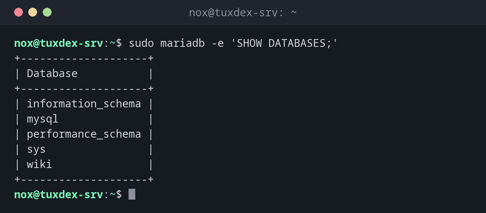

# mariadb

> Der Kommandozeilen-Client von MariaDB und MySQL: verbinden, SQL ausführen und Benutzer, Datenbanken und Rechte verwalten.



## Syntax

```bash
mariadb [-u BENUTZER] [-p] [-h HOST] [DATENBANK] [-e 'SQL']
```

## Optionen

| Option | Beschreibung |
|--------|--------------|
| `-u BENUTZER` | Datenbankbenutzer |
| `-p` | Nach dem Passwort fragen (`-pGEHEIM` ohne Leerzeichen nur in Tests) |
| `-h HOST`, `-P PORT` | Server und Port, Standard lokaler Socket |
| `-e 'SQL'` | Befehle ausführen und beenden |
| `-N`, `-B` | Keine Spaltennamen; mit Tabs getrennt (für Skripte) |
| `-t` | Tabelle mit Rahmen, auch wenn die Ausgabe in eine Pipe geht |

`mysql` ist ein Alias für `mariadb`. Im Client: `SHOW DATABASES;`, `USE DB;`, `SHOW TABLES;`, `DESCRIBE TABELLE;`, `\G` am Ende einer Abfrage für senkrechte Ausgabe, `exit` zum Beenden.

## Beispiele

**Alle Datenbanken:**

```bash
sudo mariadb -e 'SHOW DATABASES;'
```

```text
+--------------------+
| Database           |
+--------------------+
| information_schema |
| mysql              |
| performance_schema |
| sys                |
| wiki               |
+--------------------+
```

**Datenbank und Benutzer für eine Anwendung:**

```bash
sudo mariadb
```

```text
Welcome to the MariaDB monitor.  Commands end with ; or \g.
Your MariaDB connection id is 31
Server version: 11.8.6-MariaDB-0+deb13u1 from Debian

Copyright (c) 2000, 2018, Oracle, MariaDB Corporation Ab and others.

Type 'help;' or '\h' for help. Type '\c' to clear the current input statement.

MariaDB [(none)]> CREATE DATABASE wiki CHARACTER SET utf8mb4 COLLATE utf8mb4_unicode_ci;
Query OK, 1 row affected (0.001 sec)

MariaDB [(none)]> CREATE USER 'wiki'@'localhost' IDENTIFIED BY 'secret';
Query OK, 0 rows affected (0.003 sec)

MariaDB [(none)]> GRANT ALL PRIVILEGES ON wiki.* TO 'wiki'@'localhost';
Query OK, 0 rows affected (0.002 sec)
```

**Alle Benutzer mit ihren Hosts:**

```bash
sudo mariadb -e 'SELECT User, Host FROM mysql.user;'
```

```text
+-------------+-----------+
| User        | Host      |
+-------------+-----------+
| report      | 192.0.2.% |
| mariadb.sys | localhost |
| mysql       | localhost |
| root        | localhost |
| wiki        | localhost |
+-------------+-----------+
```

**Welche Rechte ein Benutzer hat:**

```bash
sudo mariadb -e "SHOW GRANTS FOR 'report'@'192.0.2.%';"
```

```text
+---------------------------------------------------------------------------------------------------------------+
| Grants for report@192.0.2.%                                                                                   |
+---------------------------------------------------------------------------------------------------------------+
| GRANT USAGE ON *.* TO `report`@`192.0.2.%` IDENTIFIED BY PASSWORD '*305D7BCA9D65D8D5C4677F05CD2EA2EBE350158F' |
| GRANT SELECT ON `wiki`.* TO `report`@`192.0.2.%`                                                              |
+---------------------------------------------------------------------------------------------------------------+
```

`USAGE` heißt nur „darf sich anmelden“. Das eigentliche Recht ist `SELECT` auf die Datenbank `wiki`.

**Als Anwendungsbenutzer anmelden:**

```bash
mariadb -u wiki -p wiki -e 'SELECT * FROM pages;'
```

```text
Enter password:
+----+---------+---------------------+
| id | title   | updated             |
+----+---------+---------------------+
|  1 | Home    | 2026-10-26 10:42:17 |
|  2 | Install | 2026-10-26 10:42:17 |
|  3 | Backup  | 2026-10-26 10:42:17 |
+----+---------+---------------------+
```

**Falsches Passwort oder kein Benutzer für diesen Host:**

```bash
mariadb -u wiki -p wiki
```

```text
Enter password:
ERROR 1045 (28000): Access denied for user 'wiki'@'localhost' (using password: YES)
```

**Größe der Datenbanken in MB:**

```bash
sudo mariadb -e 'SELECT table_schema AS db, ROUND(SUM(data_length+index_length)/1024/1024,2) AS mb FROM information_schema.tables GROUP BY table_schema;'
```

```text
+--------------------+------+
| db                 | mb   |
+--------------------+------+
| information_schema | 0.20 |
| mysql              | 3.37 |
| performance_schema | 0.00 |
| sys                | 0.03 |
| wiki               | 0.02 |
+--------------------+------+
```

## Wann brauche ich das?

- Um für eine neue Anwendung eine Datenbank und einen Benutzer anzulegen
- Um Rechte zu vergeben oder zu prüfen
- In Skripten mit `-N -B -e`

!!! tip "Passwörter in `~/.my.cnf`"
    Ein Abschnitt `[client]` mit `user=` und `password=` in `~/.my.cnf` (Rechte `600`) erspart
    die Abfrage. Als Linux-`root` braucht `sudo mariadb` ohnehin kein Passwort.

!!! warning "Benutzer heißt Name und Host"
    `'wiki'@'localhost'` und `'wiki'@'%'` sind verschiedene Benutzer. Scheitert eine Anmeldung,
    obwohl das Passwort stimmt, prüf mit `SELECT User, Host FROM mysql.user;`, welcher Host passt.

## Unterschiede zwischen Distributionen

| | Debian | Ubuntu | RHEL | Arch |
|---|--------|--------|------|------|
| Paket | `mariadb-client` | `mariadb-client` | `mariadb` | `mariadb-clients` |

## Verwandte Befehle

[mariadb-admin](mariadb-admin.md) · [mariadb-secure-installation](mariadb-secure-installation.md) · [mysqldump](../28-backup/mysqldump.md) · [psql](psql.md)
