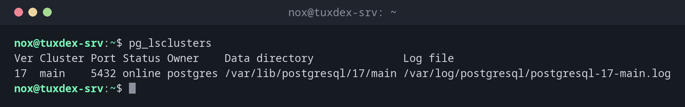

# pg_lsclusters

> Lists all PostgreSQL clusters on the server with version, port, state and data directory. Only on Debian and Ubuntu.



## Syntax

```bash
pg_lsclusters [-h] [--json]
```

## Options

| Option | Description |
|--------|-------------|
| `-h` | No header line |
| `--json` | Output as JSON |

Related tools from the same package: `pg_ctlcluster 17 main start|stop|restart|reload`, `pg_createcluster`, `pg_dropcluster` and `pg_upgradecluster` for major upgrades. The systemd unit for a cluster is `postgresql@17-main`.

## Examples

**All clusters on the server:**

```bash
pg_lsclusters
```

```text
Ver Cluster Port Status Owner    Data directory              Log file
17  main    5432 online postgres /var/lib/postgresql/17/main /var/log/postgresql/postgresql-17-main.log
```

**After a distribution upgrade from Debian 12:**

```bash
pg_lsclusters
```

```text
Ver Cluster Port Status Owner    Data directory              Log file
15  main    5432 online postgres /var/lib/postgresql/15/main /var/log/postgresql/postgresql-15-main.log
17  main    5433 online postgres /var/lib/postgresql/17/main /var/log/postgresql/postgresql-17-main.log
```

The data is still in version 15 on port 5432. The empty 17 cluster is in the way of `pg_upgradecluster`: remove it first with `sudo pg_dropcluster 17 main --stop`.

**Stop a cluster and check:**

```bash
sudo pg_ctlcluster 17 main stop
pg_lsclusters -h
```

```text
17  main    5432 down   postgres /var/lib/postgresql/17/main /var/log/postgresql/postgresql-17-main.log
```

## When do I need it?

- To see which PostgreSQL versions run on a server and on which port
- Before and after a major upgrade, e.g. from 16 to 17
- When `psql` can't connect: is the cluster running at all?

!!! tip "Major upgrade on Debian"
    After a distribution upgrade the old cluster keeps running. `sudo pg_upgradecluster 16 main`
    copies it to the new version; check the application, then delete the old one with
    `sudo pg_dropcluster 16 main`.

!!! warning "Two clusters, two ports"
    If the new version was installed while the old one still runs, the new cluster gets port
    5433. Applications keep talking to the old one on 5432 until you switch the ports.

## Distribution differences

| | Debian | Ubuntu | RHEL | Arch |
|---|--------|--------|------|------|
| Available | yes (`postgresql-common`) | yes (`postgresql-common`) | no: `systemctl status postgresql` | no: `systemctl status postgresql` |

## Related commands

[pg_isready](pg_isready.md) · [psql](psql.md) · [systemctl](../09-systemd/systemctl.md) · [apt](../10-packages/apt.md)
