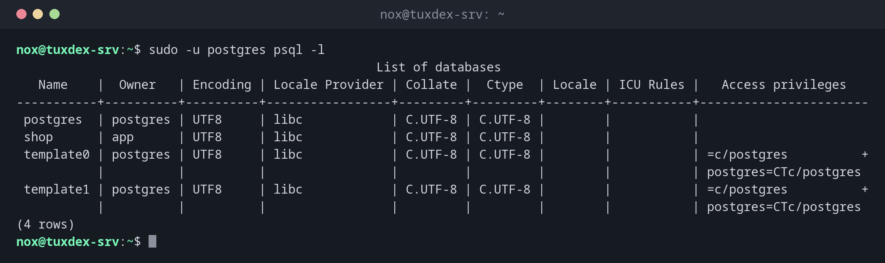

# psql

> Der Kommandozeilen-Client von PostgreSQL: mit einer Datenbank verbinden, SQL ausführen und Datenbanken, Rollen und Tabellen mit Backslash-Befehlen untersuchen.



## Syntax

```bash
psql [-h HOST] [-p PORT] [-U BENUTZER] [-d DATENBANK] [-c 'SQL']
```

## Optionen

| Option | Beschreibung |
|--------|--------------|
| `-h HOST` | Per TCP verbinden statt über den lokalen Socket |
| `-U BENUTZER`, `-d DB` | Datenbankrolle und Datenbank |
| `-c 'SQL'` | Einen Befehl ausführen und beenden |
| `-f DATEI` | Die SQL-Befehle aus einer Datei ausführen |
| `-l` | Alle Datenbanken auflisten |
| `-t`, `-A` | Nur Zeilen, keine Überschrift; ohne Ausrichtung (für Skripte) |

Innerhalb von `psql`: `\l` Datenbanken, `\du` Rollen, `\dt` Tabellen, `\d TABELLE` Aufbau, `\c DB` Datenbank wechseln, `\x` senkrechte Ausgabe, `\conninfo` aktuelle Verbindung, `\q` beenden.

## Beispiele

**Alle Datenbanken auf dem Server:**

```bash
sudo -u postgres psql -l
```

```text
                                                 List of databases
   Name    |  Owner   | Encoding | Locale Provider | Collate |  Ctype  | Locale | ICU Rules |   Access privileges
-----------+----------+----------+-----------------+---------+---------+--------+-----------+-----------------------
 postgres  | postgres | UTF8     | libc            | C.UTF-8 | C.UTF-8 |        |           |
 shop      | app      | UTF8     | libc            | C.UTF-8 | C.UTF-8 |        |           |
 template0 | postgres | UTF8     | libc            | C.UTF-8 | C.UTF-8 |        |           | =c/postgres          +
           |          |          |                 |         |         |        |           | postgres=CTc/postgres
 template1 | postgres | UTF8     | libc            | C.UTF-8 | C.UTF-8 |        |           | =c/postgres          +
           |          |          |                 |         |         |        |           | postgres=CTc/postgres
(4 rows)

```

**Rollen und ihre Eigenschaften:**

```bash
sudo -u postgres psql -c '\du'
```

```text
                             List of roles
 Role name |                         Attributes
-----------+------------------------------------------------------------
 app       |
 nox       |
 postgres  | Superuser, Create role, Create DB, Replication, Bypass RLS

```

**Als Anwendungsbenutzer mit Passwort verbinden:**

```bash
psql -h localhost -U app -d shop -c '\dt'
```

```text
Password for user app:
        List of relations
 Schema |  Name  | Type  | Owner
--------+--------+-------+-------
 public | orders | table | app
(1 row)

```

**Eine Abfrage ausführen:**

```bash
psql -h localhost -U app -d shop -c 'SELECT customer, total FROM orders ORDER BY total DESC;'
```

```text
Password for user app:
 customer | total
----------+--------
 Ben      | 120.00
 Anna     |  49.90
 Clara    |  15.50
(3 rows)

```

**Nur der Wert, für Skripte:**

```bash
sudo -u postgres psql -d shop -tAc 'SELECT count(*) FROM orders'
```

```text
3
```

**Die Peer-Anmeldung scheitert:**

```bash
psql -d shop -U app
```

```text
psql: error: connection to server on socket "/var/run/postgresql/.s.PGSQL.5432" failed: FATAL:  Peer authentication failed for user "app"
```

Über den Socket lässt PostgreSQL nur den Linux-Benutzer `app` als Rolle `app` herein. Verbinde dich stattdessen per TCP mit Passwort: `psql -h localhost -U app -d shop`.

**Größe aller Datenbanken:**

```bash
sudo -u postgres psql -c 'SELECT datname, pg_size_pretty(pg_database_size(datname)) FROM pg_database ORDER BY 1;'
```

```text
  datname  | pg_size_pretty
-----------+----------------
 postgres  | 7510 kB
 shop      | 7606 kB
 template0 | 7353 kB
 template1 | 7510 kB
(4 rows)

```

## Wann brauche ich das?

- Um in eine Datenbank zu schauen: welche Tabellen, wie viele Zeilen, wem gehört was
- Um als Admin Rollen anzulegen, Rechte zu vergeben oder Einstellungen zu ändern
- In Skripten und Health Checks mit `-tAc`

!!! tip "Passwörter für Skripte in `~/.pgpass`"
    Eine Zeile `localhost:5432:shop:app:secret` in `~/.pgpass` (Rechte `600`) erspart die
    Passwortabfrage. Passwörter gehören nie in die Kommandozeile oder als `PGPASSWORD` in
    geteilte Skripte.

!!! warning "Jede Anweisung wirkt sofort"
    `psql` schreibt jede Anweisung sofort fest. Tipp vor einem riskanten `UPDATE` oder `DELETE`
    `BEGIN;`, prüf das Ergebnis und schließ mit `COMMIT;` oder `ROLLBACK;` ab.

## Unterschiede zwischen Distributionen

| | Debian | Ubuntu | RHEL | Arch |
|---|--------|--------|------|------|
| Paket | `postgresql-client` | `postgresql-client` | `postgresql` | `postgresql-libs` |

## Verwandte Befehle

[createuser](createuser.md) · [createdb](createdb.md) · [pg_isready](pg_isready.md) · [pg_dump](../28-backup/pg_dump.md)
