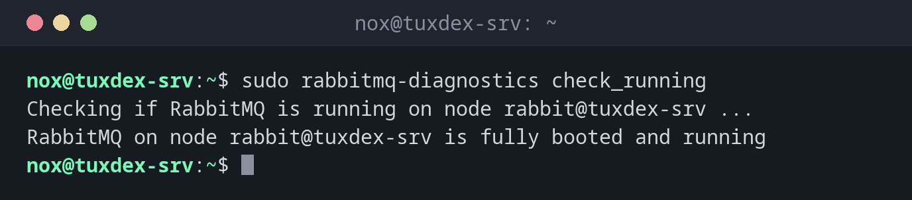

# rabbitmq-diagnostics

> Health Checks und Diagnose für RabbitMQ: Läuft der Knoten, gibt es Alarme, auf welchen Ports lauscht er, wohin geht der Speicher?



## Syntax

```bash
rabbitmq-diagnostics BEFEHL [OPTIONEN]
```

## Optionen

| Befehl | Beschreibung |
|--------|--------------|
| `ping` | Ist der Prozess des Knotens erreichbar |
| `check_running` | Ist RabbitMQ vollständig gestartet |
| `check_local_alarms`, `alarms` | Speicher- oder Plattenalarme, die Sender blockieren |
| `listeners` | Ports und Protokolle |
| `check_port_connectivity` | Sind alle Listener tatsächlich erreichbar |
| `memory_breakdown --unit mb` | Speicherverbrauch nach Kategorie |
| `check_virtual_hosts` | Laufen alle vhosts |
| `server_version` | Version des Knotens |

Alle `check_*`-Befehle liefern bei Erfolg den Exit-Code `0`, sonst einen anderen. Damit passen sie in Health Checks und Monitoring-Skripte.

## Beispiele

**Ist RabbitMQ vollständig gestartet:**

```bash
sudo rabbitmq-diagnostics check_running
```

```text
Checking if RabbitMQ is running on node rabbit@tuxdex-srv ...
RabbitMQ on node rabbit@tuxdex-srv is fully booted and running
```

**Ein schneller Ping:**

```bash
sudo rabbitmq-diagnostics ping
```

```text
Will ping rabbit@tuxdex-srv. This only checks if the OS process is running and registered with epmd. Timeout: 60000 ms.
Ping succeeded
```

**Gibt es Alarme:**

```bash
sudo rabbitmq-diagnostics alarms
```

```text
Asking node rabbit@tuxdex-srv to report any known resource alarms ...
Node rabbit@tuxdex-srv reported no alarms, local or clusterwide
```

**Ports und Protokolle:**

```bash
sudo rabbitmq-diagnostics listeners
```

```text
Asking node rabbit@tuxdex-srv to report its protocol listeners ...
Interface: [::], port: 25672, protocol: clustering, purpose: inter-node and CLI tool communication
Interface: [::], port: 5672, protocol: amqp, purpose: AMQP 0-9-1 and AMQP 1.0
Interface: [::], port: 15672, protocol: http, purpose: HTTP API
```

**Sind die Ports erreichbar:**

```bash
sudo rabbitmq-diagnostics check_port_connectivity
```

```text
Testing TCP connections to all active listeners on node rabbit@tuxdex-srv using hostname resolution ...
Will connect to tuxdex-srv:25672
Will connect to tuxdex-srv:5672
Will connect to tuxdex-srv:15672
Successfully connected to ports 5672, 15672, 25672 on node rabbit@tuxdex-srv (using node hostname resolution)
```

**Wohin der Speicher geht:**

```bash
sudo rabbitmq-diagnostics memory_breakdown --unit mb | head -6
```

```text
Reporting memory breakdown on node rabbit@tuxdex-srv...
reserved_unallocated: 62.5746 mb (43.4%)
other_system: 24.8761 mb (17.25%)
code: 23.1151 mb (16.03%)
other_proc: 19.0796 mb (13.23%)
allocated_unused: 8.6889 mb (6.03%)
```

## Wann brauche ich das?

- Als Health Check für systemd, Docker oder ein Monitoring-System
- Wenn Anwendungen nichts mehr senden können: Gibt es einen Speicher- oder Plattenalarm?
- Um nach einer Änderung zu prüfen, auf welchen Ports RabbitMQ lauscht

!!! tip "Stufen von Health Checks"
    Von günstig bis gründlich: `ping` → `check_running` → `check_local_alarms` →
    `check_port_connectivity`. Für einen Container-Health-Check reicht meist `ping`.

!!! warning "Alarme stoppen Sender"
    Braucht RabbitMQ mehr als seine Speichergrenze (`vm_memory_high_watermark`, 0,6 des RAM)
    oder fällt der freie Plattenplatz unter `disk_free_limit`, blockiert es alle sendenden
    Verbindungen. Die Anwendung hängt dann ohne Fehlermeldung.

## Unterschiede zwischen Distributionen

| | Debian | Ubuntu | RHEL | Arch |
|---|--------|--------|------|------|
| Paket | `rabbitmq-server` | `rabbitmq-server` | nicht in den Paketquellen: Paketquelle des RabbitMQ-Teams | `rabbitmq` |

## Verwandte Befehle

[rabbitmqctl](rabbitmqctl.md) · [rabbitmq-plugins](rabbitmq-plugins.md) · [ss](../11-network/ss.md) · [systemctl](../09-systemd/systemctl.md)
