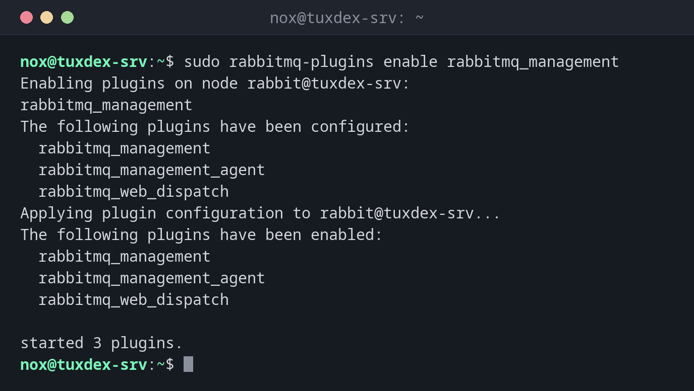

# rabbitmq-plugins

> Listet RabbitMQ-Plugins auf und schaltet sie ein oder aus, etwa die Weboberfläche `rabbitmq_management`.



## Syntax

```bash
rabbitmq-plugins list [-e] | enable PLUGIN... | disable PLUGIN...
```

## Optionen

| Befehl | Beschreibung |
|--------|--------------|
| `list` | Alle Plugins mit ihrem Zustand |
| `list -e` | Nur eingeschaltete Plugins |
| `enable PLUGIN` | Ein Plugin samt Abhängigkeiten einschalten |
| `disable PLUGIN` | Ein Plugin ausschalten |
| `--offline` | Nur die Datei ändern, für einen Knoten, der nicht läuft |

In der Liste heißt `E` ausdrücklich eingeschaltet, `e` als Abhängigkeit eingeschaltet, `*` läuft. Die Einstellung steht in `/etc/rabbitmq/enabled_plugins`.

## Beispiele

**Die Weboberfläche einschalten:**

```bash
sudo rabbitmq-plugins enable rabbitmq_management
```

```text
Enabling plugins on node rabbit@tuxdex-srv:
rabbitmq_management
The following plugins have been configured:
  rabbitmq_management
  rabbitmq_management_agent
  rabbitmq_web_dispatch
Applying plugin configuration to rabbit@tuxdex-srv...
The following plugins have been enabled:
  rabbitmq_management
  rabbitmq_management_agent
  rabbitmq_web_dispatch

started 3 plugins.
```

**Nur die eingeschalteten Plugins:**

```bash
sudo rabbitmq-plugins list -e
```

```text
Listing plugins with pattern ".*" ...
 Configured: E = explicitly enabled; e = implicitly enabled
 | Status: * = running on rabbit@tuxdex-srv
 |/
[E*] rabbitmq_management       4.0.5
[e*] rabbitmq_management_agent 4.0.5
[e*] rabbitmq_web_dispatch     4.0.5
```

**Alle verfügbaren Plugins:**

```bash
sudo rabbitmq-plugins list | head -8
```

```text
Listing plugins with pattern ".*" ...
 Configured: E = explicitly enabled; e = implicitly enabled
 | Status: * = running on rabbit@tuxdex-srv
 |/
[  ] rabbitmq_amqp1_0                  4.0.5
[  ] rabbitmq_auth_backend_cache       4.0.5
[  ] rabbitmq_auth_backend_http        4.0.5
[  ] rabbitmq_auth_backend_ldap        4.0.5
```

## Wann brauche ich das?

- Um die Weboberfläche auf Port 15672 einzuschalten
- Für Metriken in Prometheus: `rabbitmq_prometheus` auf Port 15692
- Um nach einem Upgrade zu prüfen, welche Plugins laufen

!!! tip "Metriken für Prometheus"
    `sudo rabbitmq-plugins enable rabbitmq_prometheus` bietet Metriken auf
    `http://tuxdex-srv:15692/metrics` an. Trag die Adresse als Ziel in die
    [Prometheus-Konfiguration](../32-monitoring/basics.md) ein.

!!! warning "Die Weboberfläche ist eine Tür"
    Port 15672 erlaubt die volle Kontrolle über RabbitMQ. Erlaube ihn nur aus dem Admin-Netz
    oder geh über einen SSH-Tunnel: `ssh -L 15672:localhost:15672 nox@tuxdex-srv`.

## Unterschiede zwischen Distributionen

| | Debian | Ubuntu | RHEL | Arch |
|---|--------|--------|------|------|
| Paket | `rabbitmq-server` | `rabbitmq-server` | nicht in den Paketquellen: Paketquelle des RabbitMQ-Teams | `rabbitmq` |

## Verwandte Befehle

[rabbitmqctl](rabbitmqctl.md) · [rabbitmq-diagnostics](rabbitmq-diagnostics.md) · [ssh](../12-ssh/ssh.md)
