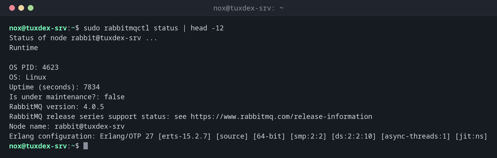

# rabbitmqctl

> Verwaltet einen RabbitMQ-Server: Benutzer, Virtual Hosts und Rechte, Queues und Verbindungen, dazu den Zustand des Knotens.



## Syntax

```bash
rabbitmqctl BEFEHL [-p VHOST] [ARGUMENTE]
```

## Optionen

| Befehl | Beschreibung |
|--------|--------------|
| `status` | Zustand des Knotens: Version, Speicher, Alarme, Listener |
| `add_user`, `delete_user`, `change_password` | Benutzer verwalten |
| `set_user_tags BENUTZER administrator` | Rechte für die Weboberfläche |
| `add_vhost`, `list_vhosts` | Virtual Hosts verwalten |
| `set_permissions -p VHOST BENUTZER KONF SCHREIB LESE` | Rechte als reguläre Ausdrücke |
| `list_users`, `list_permissions -p VHOST` | Benutzer und Rechte zeigen |
| `list_queues -p VHOST [SPALTEN]` | Queues mit Nachrichtenzahlen |
| `purge_queue`, `delete_queue` | Eine Queue leeren oder löschen |
| `list_connections` | Verbundene Anwendungen |

`rabbitmqctl` spricht über die Erlang-Distribution mit dem Knoten und braucht dasselbe `.erlang.cookie`. Führ es mit `sudo` aus; unter Debian wechselt es selbst zum Benutzer `rabbitmq`.

## Beispiele

**Zustand des Knotens:**

```bash
sudo rabbitmqctl status | head -12
```

```text
Status of node rabbit@tuxdex-srv ...
Runtime

OS PID: 4623
OS: Linux
Uptime (seconds): 7834
Is under maintenance?: false
RabbitMQ version: 4.0.5
RabbitMQ release series support status: see https://www.rabbitmq.com/release-information
Node name: rabbit@tuxdex-srv
Erlang configuration: Erlang/OTP 27 [erts-15.2.7] [source] [64-bit] [smp:2:2] [ds:2:2:10] [async-threads:1] [jit:ns]
```

**Eine Anwendung einrichten: vhost, Benutzer, Rechte:**

```bash
sudo rabbitmqctl add_vhost shop
sudo rabbitmqctl add_user shop
sudo rabbitmqctl set_permissions -p shop shop '.*' '.*' '.*'
```

```text
Adding vhost "shop" ...
Adding user "shop" ...
Done. Don't forget to grant the user permissions to some virtual hosts! See 'rabbitmqctl help set_permissions' to learn more.
Setting permissions for user "shop" in vhost "shop" ...
```

**Ein Admin-Konto für die Weboberfläche:**

```bash
sudo rabbitmqctl add_user nox
sudo rabbitmqctl set_user_tags nox administrator
sudo rabbitmqctl delete_user guest
```

```text
Adding user "nox" ...
Done. Don't forget to grant the user permissions to some virtual hosts! See 'rabbitmqctl help set_permissions' to learn more.
Setting tags for user "nox" to [administrator] ...
Deleting user "guest" ...
```

**Benutzer und vhosts:**

```bash
sudo rabbitmqctl list_users
sudo rabbitmqctl list_vhosts
```

```text
Listing users ...
user    tags
nox    [administrator]
shop    []
Listing vhosts ...
name
shop
/
```

**Queues mit wartenden Nachrichten und Consumern:**

```bash
sudo rabbitmqctl list_queues -p shop name type messages_ready messages_unacknowledged consumers
```

```text
Timeout: 60.0 seconds ...
Listing queues for vhost shop ...
name    type    messages_ready    messages_unacknowledged    consumers
mails    quorum    3    0    1
orders    quorum    1482    0    0
```

1482 Bestellungen warten, und kein Consumer ist verbunden: Der Bestell-Worker läuft nicht.

**Ein Passwort prüfen:**

```bash
sudo rabbitmqctl authenticate_user shop 'wrong'
```

```text
Authenticating user "shop" ...
Error:
Error: failed to authenticate user "shop"
user 'shop' - invalid credentials
```

## Wann brauche ich das?

- Um eine neue Anwendung einzurichten: vhost, Benutzer und Rechte
- Wenn sich Nachrichten stauen: Welche Queue ist voll, sind Consumer verbunden?
- Um auf Produktivsystemen den Benutzer `guest` zu entfernen

!!! tip "Die Länge der Queues beobachten"
    Steigt `messages_ready` immer weiter, während `consumers` bei `0` steht, ist der Worker
    ausgefallen. Das ist der wichtigste Wert für das Monitoring eines RabbitMQ-Servers.

!!! warning "Passwörter in der Shell-History"
    `rabbitmqctl add_user shop geheim` landet in der History. Lass das Passwort weg: Dann
    liest `rabbitmqctl` es von der Standardeingabe, und es bleibt aus der History.

!!! danger "`purge_queue` löscht unerledigte Aufträge"
    Das Leeren löscht alle wartenden Nachrichten, etwa Bestellungen oder noch nicht verschickte
    Mails. Stell sicher, dass sie wirklich überflüssig sind.

## Unterschiede zwischen Distributionen

| | Debian | Ubuntu | RHEL | Arch |
|---|--------|--------|------|------|
| Paket | `rabbitmq-server` | `rabbitmq-server` | nicht in den Paketquellen: Paketquelle des RabbitMQ-Teams | `rabbitmq` |

## Verwandte Befehle

[rabbitmq-diagnostics](rabbitmq-diagnostics.md) · [rabbitmq-plugins](rabbitmq-plugins.md) · [systemctl](../09-systemd/systemctl.md)
