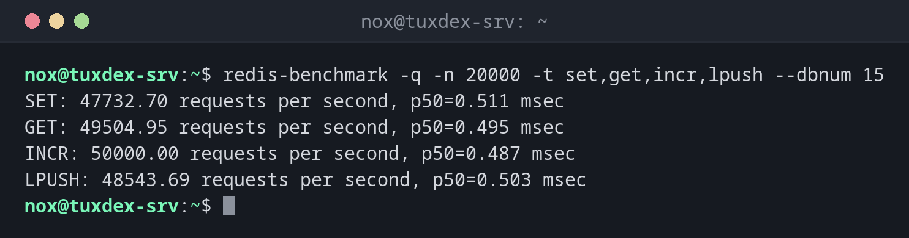

# redis-benchmark

> Measures how many requests per second a Redis or Valkey server handles, and with which latency.



## Syntax

```bash
redis-benchmark [-h HOST] [-p PORT] [-n REQUESTS] [-c CLIENTS] [-d BYTES] [-t TESTS] [-q]
```

## Options

| Option | Description |
|--------|-------------|
| `-n N` | Number of requests per test, default 100000 |
| `-c N` | Parallel clients, default 50 |
| `-d BYTES` | Size of the values for `SET` and `GET`, default 3 |
| `-t TESTS` | Only these tests, e.g. `set,get,incr,lpush` |
| `-P N` | Pipeline: send N commands at once |
| `-q` | Only one result line per test |
| `--csv` | Output as CSV |

The tests write keys like `key:__rand_int__` into the database. Run them against a test instance or an empty database number (`--dbnum 15`).

## Examples

**A quick overview:**

```bash
redis-benchmark -q -n 20000 -t set,get,incr,lpush --dbnum 15
```

```text
SET: 47732.70 requests per second, p50=0.511 msec
GET: 49504.95 requests per second, p50=0.495 msec
INCR: 50000.00 requests per second, p50=0.487 msec
LPUSH: 48543.69 requests per second, p50=0.503 msec
```

**GET with 1 KB values and the latency distribution:**

```bash
redis-benchmark -n 10000 -t get -c 50 -d 1024 --dbnum 15 | tail -6
```

```text
Summary:
  throughput summary: 45454.55 requests per second
  latency summary (msec):
          avg       min       p50       p95       p99       max
        0.561     0.152     0.527     0.791     1.247     3.519
```

**Faster with a pipeline:**

```bash
redis-benchmark -q -n 100000 -t get -P 16 --dbnum 15
```

```text
GET: 409836.06 requests per second, p50=1.623 msec
```

With 16 commands per round trip the throughput rises about eightfold. Applications get the same effect with pipelining in their Redis library.

**The server isn't reachable:**

```bash
redis-benchmark -q -h 192.0.2.22 -n 1000 -t ping
```

```text
Could not connect to Redis at 192.0.2.22:6379: Connection refused
```

## When do I need it?

- To check whether a new server or a new configuration is fast enough
- To compare Redis via TCP with a Unix socket, or Redis with Valkey
- To tell whether a slowdown is caused by Redis or by the network

!!! tip "Measure from the application server"
    Run the benchmark once on the Redis server and once from the application server. If the
    numbers differ a lot, the network is the bottleneck, not Redis.

!!! warning "Not on a production instance"
    The benchmark creates load and writes its own keys. On a production server that slows
    down the application and may push real cache entries out of memory.

## Distribution differences

| | Debian | Ubuntu | RHEL | Arch |
|---|--------|--------|------|------|
| Package | `redis-tools` (or `valkey-tools`) | `redis-tools` | `redis` (RHEL 9), `valkey` (RHEL 10) | `valkey` |
| Command | `redis-cli` (or `valkey-cli`) | `redis-cli` | `redis-cli` or `valkey-cli` | `valkey-cli` |

## Related commands

[redis-cli](redis-cli.md) · [ab](../29-webserver/ab.md) · [ping](../11-network/ping.md)
