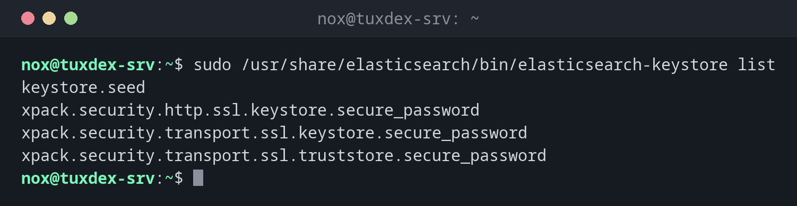

# elasticsearch-keystore

> Manages the keystore of Elasticsearch: a protected file for secret settings such as passwords and S3 keys that don't belong in `elasticsearch.yml`.



## Syntax

```bash
sudo /usr/share/elasticsearch/bin/elasticsearch-keystore list | add [-x] SETTING | show SETTING | remove SETTING
```

## Options

| Command | Description |
|---------|-------------|
| `list` | Names of all stored settings |
| `add SETTING` | Add a setting; the value is asked for |
| `add -x SETTING` | Read the value from stdin (for scripts) |
| `add-file SETTING FILE` | Store the content of a file, e.g. a credentials file |
| `show SETTING` | Show a stored value |
| `remove SETTING` | Delete a setting |
| `passwd` | Protect the keystore itself with a password |

The file is `/etc/elasticsearch/elasticsearch.keystore`. Changes take effect after a restart; some settings, like S3 credentials, can be reloaded with `POST /_nodes/reload_secure_settings`. OpenSearch has the same tool as `opensearch-keystore`.

## Examples

**What is stored:**

```bash
sudo /usr/share/elasticsearch/bin/elasticsearch-keystore list
```

```text
keystore.seed
xpack.security.http.ssl.keystore.secure_password
xpack.security.transport.ssl.keystore.secure_password
xpack.security.transport.ssl.truststore.secure_password
```

**Add S3 access data for snapshots:**

```bash
sudo /usr/share/elasticsearch/bin/elasticsearch-keystore add s3.client.default.access_key
sudo /usr/share/elasticsearch/bin/elasticsearch-keystore add s3.client.default.secret_key
```

```text
Enter value for s3.client.default.access_key:
Enter value for s3.client.default.secret_key:
```

**From a script, without a prompt:**

```bash
printf '%s' "$S3_KEY" | sudo /usr/share/elasticsearch/bin/elasticsearch-keystore add -x s3.client.default.access_key
sudo /usr/share/elasticsearch/bin/elasticsearch-keystore list | grep s3
```

```text
s3.client.default.access_key
s3.client.default.secret_key
```

**Load the new values without a restart:**

```bash
curl --cacert /etc/elasticsearch/certs/http_ca.crt -u elastic https://localhost:9200/_nodes/reload_secure_settings -X POST -s | jq '._nodes'
```

```text
Enter host password for user 'elastic':
{
  "total": 1,
  "successful": 1,
  "failed": 0
}
```

**The password of the HTTP certificate:**

```bash
sudo /usr/share/elasticsearch/bin/elasticsearch-keystore show xpack.security.http.ssl.keystore.secure_password
```

```text
pV3sKq9TzR2mWx7YbN4c
```

## When do I need it?

- To give Elasticsearch access data for an S3 snapshot repository
- To look up the passwords of the TLS keystores that the installation created
- Before a cluster grows: every node needs the same secure settings

!!! tip "Same keystore on every node"
    Secure settings are not copied between nodes. Add them on every node with the same
    values, then call `reload_secure_settings` once.

!!! warning "Not a vault"
    Without `passwd` the keystore is only obfuscated, and `show` prints every value. Protect
    the file with mode `660` and owner `root:elasticsearch`, as the package sets it.

## Distribution differences

| | Debian | Ubuntu | RHEL | Arch |
|---|--------|--------|------|------|
| Installation | APT repository of Elastic | APT repository of Elastic | YUM repository of Elastic | AUR or container |
| Path | `/usr/share/elasticsearch/bin/` | `/usr/share/elasticsearch/bin/` | `/usr/share/elasticsearch/bin/` | depends on the package |

## Related commands

[elasticsearch-reset-password](elasticsearch-reset-password.md) · [elasticsearch-plugin](elasticsearch-plugin.md) · [restic](../28-backup/restic.md) · [chmod](../06-permissions/chmod.md)
