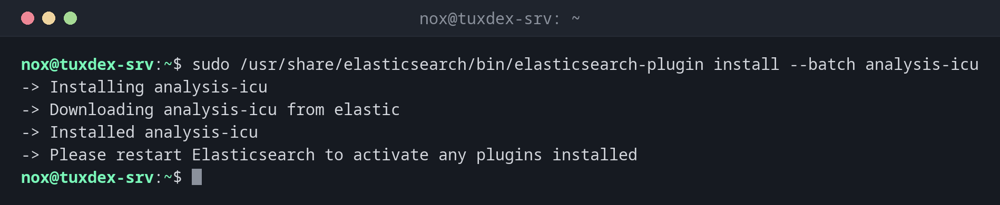

# elasticsearch-plugin

> Installiert, listet und entfernt Plugins für Elasticsearch, etwa zusätzliche Sprachanalysen.



## Syntax

```bash
sudo /usr/share/elasticsearch/bin/elasticsearch-plugin list | install [--batch] PLUGIN | remove PLUGIN
```

## Optionen

| Befehl | Beschreibung |
|--------|--------------|
| `list` | Installierte Plugins |
| `install PLUGIN` | Ein offizielles Plugin nach Namen installieren oder von einer URL bzw. einem `file://`-Pfad |
| `install --batch` | Nicht nach zusätzlichen Berechtigungen fragen |
| `remove PLUGIN` | Ein Plugin entfernen |
| `remove --purge` | Auch seine Konfiguration löschen |

Plugins müssen genau die Version von Elasticsearch haben, und jeder Knoten braucht dieselben Plugins. Änderungen wirken nach `sudo systemctl restart elasticsearch`. OpenSearch: `opensearch-plugin` mit denselben Befehlen.

## Beispiele

**Ein Plugin installieren:**

```bash
sudo /usr/share/elasticsearch/bin/elasticsearch-plugin install --batch analysis-icu
```

```text
-> Installing analysis-icu
-> Downloading analysis-icu from elastic
-> Installed analysis-icu
-> Please restart Elasticsearch to activate any plugins installed
```

**Installierte Plugins:**

```bash
sudo /usr/share/elasticsearch/bin/elasticsearch-plugin list
```

```text
analysis-icu
```

**Aktivieren und prüfen:**

```bash
sudo systemctl restart elasticsearch
curl --cacert /etc/elasticsearch/certs/http_ca.crt -u elastic https://localhost:9200/_cat/plugins?v
```

```text
Enter host password for user 'elastic':
name       component    version
tuxdex-srv analysis-icu 9.1.0
```

**Ein Tippfehler im Namen:**

```bash
sudo /usr/share/elasticsearch/bin/elasticsearch-plugin install analysis-foo
```

```text
ERROR: Unknown plugin analysis-foo, did you mean any of [analysis-nori, analysis-icu]?, with exit code 64
```

**Ein Plugin entfernen:**

```bash
sudo /usr/share/elasticsearch/bin/elasticsearch-plugin remove analysis-icu
```

```text
-> removing [analysis-icu]...
```

## Wann brauche ich das?

- Für bessere Suche in einer Sprache, z. B. `analysis-icu` oder `analysis-kuromoji`
- Vor einem Upgrade: Welche Plugins müssen mit aktualisiert werden?
- Um herauszufinden, warum ein Knoten nach einem Upgrade nicht startet

!!! tip "Plugins auf Servern ohne Internet"
    Lade das ZIP auf einem anderen Rechner herunter und installier es mit
    `elasticsearch-plugin install file:///tmp/analysis-icu-9.1.0.zip`.

!!! warning "Plugins zusammen mit Elasticsearch aktualisieren"
    Nach einem Paket-Upgrade startet ein Knoten mit alter Plugin-Version nicht. Entferne das
    Plugin vor dem Upgrade und installier es danach in der neuen Version wieder.

## Unterschiede zwischen Distributionen

| | Debian | Ubuntu | RHEL | Arch |
|---|--------|--------|------|------|
| Installation | APT-Paketquelle von Elastic | APT-Paketquelle von Elastic | YUM-Paketquelle von Elastic | AUR oder Container |
| Pfad | `/usr/share/elasticsearch/bin/` | `/usr/share/elasticsearch/bin/` | `/usr/share/elasticsearch/bin/` | je nach Paket |

## Verwandte Befehle

[elasticsearch-keystore](elasticsearch-keystore.md) · [elasticsearch-reset-password](elasticsearch-reset-password.md) · [systemctl](../09-systemd/systemctl.md)
