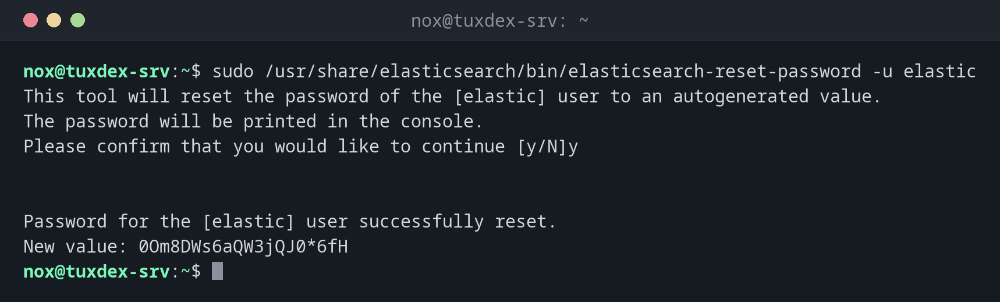

# elasticsearch-reset-password

> Sets a new password for a built-in Elasticsearch user such as `elastic` or `kibana_system`, either random or chosen by you.



## Syntax

```bash
sudo /usr/share/elasticsearch/bin/elasticsearch-reset-password -u USER [-i] [-b] [--url URL]
```

## Options

| Option | Description |
|--------|-------------|
| `-u USER` | The user, e.g. `elastic` or `kibana_system` |
| `-i` | Enter the new password yourself instead of a random one |
| `-a` | Generate a random password (the default) |
| `-b` | Batch mode: don't ask for confirmation |
| `--url URL` | Address of the node, if it isn't `https://localhost:9200` |

The tool needs a running node and changes the password through the API. OpenSearch has no such tool; there you change users in the security plugin (`internal_users.yml` or the REST API).

## Examples

**A new random password for `elastic`:**

```bash
sudo /usr/share/elasticsearch/bin/elasticsearch-reset-password -u elastic
```

```text
This tool will reset the password of the [elastic] user to an autogenerated value.
The password will be printed in the console.
Please confirm that you would like to continue [y/N]y


Password for the [elastic] user successfully reset.
New value: 0Om8DWs6aQW3jQJ0*6fH
```

**Choose the password yourself:**

```bash
sudo /usr/share/elasticsearch/bin/elasticsearch-reset-password -u kibana_system -i
```

```text
This tool will reset the password of the [kibana_system] user.
You will be prompted to enter the password.
Please confirm that you would like to continue [y/N]y


Enter password for [kibana_system]:
Re-enter password for [kibana_system]:
Password for the [kibana_system] user successfully reset.
```

**Test the new password:**

```bash
curl --cacert /etc/elasticsearch/certs/http_ca.crt -u elastic https://localhost:9200
```

```text
Enter host password for user 'elastic':
{
  "name" : "tuxdex-srv",
  "cluster_name" : "tuxdex",
  "cluster_uuid" : "NM9hQs7WTTqYnq8CmJT6kQ",
  "version" : {
    "number" : "9.1.0",
    "build_flavor" : "default",
    "build_type" : "deb",
    "build_hash" : "00e7d33bf08f1476229d9d1642e2da46cfebdd53",
    "build_date" : "2025-07-23T22:09:53.891289976Z",
    "build_snapshot" : false,
    "lucene_version" : "10.2.2",
    "minimum_wire_compatibility_version" : "8.19.0",
    "minimum_index_compatibility_version" : "8.0.0"
  },
  "tagline" : "You Know, for Search"
}
```

**Without credentials the API refuses:**

```bash
curl -s --cacert /etc/elasticsearch/certs/http_ca.crt https://localhost:9200/_cluster/health | jq -r .error.reason
```

```text
missing authentication credentials for REST request [/_cluster/health]
```

## When do I need it?

- Right after the installation, if the password shown during setup is lost
- When an admin leaves who knew the `elastic` password
- To set the password for `kibana_system` before connecting Kibana

!!! tip "Don't work as `elastic` every day"
    `elastic` is a superuser. Create personal users with suitable roles in Kibana or via the
    API, and keep `elastic` for emergencies in your password manager.

!!! warning "Applications break"
    If an application or Logstash uses the reset user, it can't connect any more until its
    configuration has the new password. Check which services use the user first.

## Distribution differences

| | Debian | Ubuntu | RHEL | Arch |
|---|--------|--------|------|------|
| Installation | APT repository of Elastic | APT repository of Elastic | YUM repository of Elastic | AUR or container |
| Path | `/usr/share/elasticsearch/bin/` | `/usr/share/elasticsearch/bin/` | `/usr/share/elasticsearch/bin/` | depends on the package |

## Related commands

[elasticsearch-keystore](elasticsearch-keystore.md) · [elasticsearch-plugin](elasticsearch-plugin.md) · [curl](../11-network/curl.md) · [jq](../05-text-processing/jq.md)
